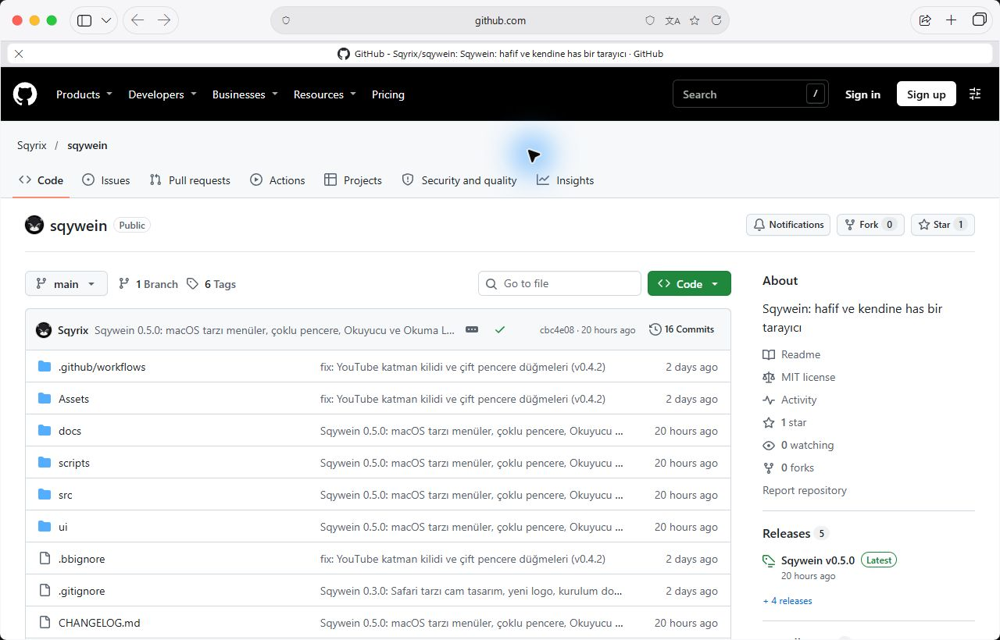
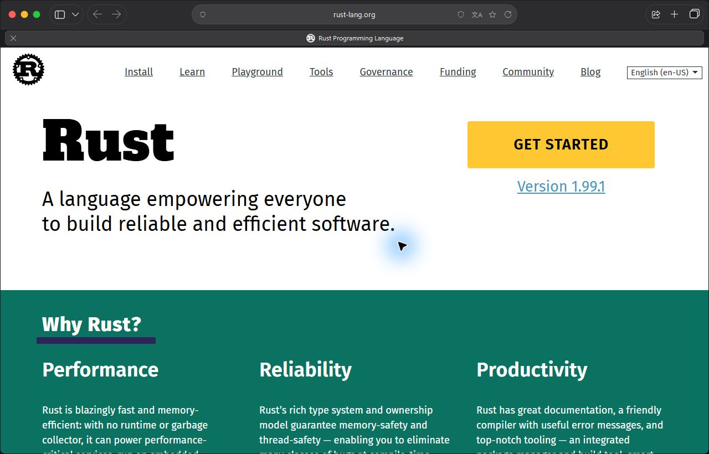

<p align="center">
  
</p>

<h1 align="center">Sqywein</h1>

<p align="center">
  <b>Windows için hafif, sade ve akıcı bir web tarayıcısı.</b><br>
  Yerel Windows arayüzü · Dahili reklam engelleme · Şifreli yerel kayıtlar · Sayfa çevirisi
</p>

<p align="center">
  <a href="https://github.com/Sqyrix/sqywein/releases/latest"><b>⬇ Son sürümü indir</b></a>
  ·
  <a href="#özellikler">Özellikler</a>
  ·
  <a href="#ölçümler">Ölçümler</a>
  ·
  <a href="#testler">Testler</a>
  ·
  <a href="#klavye-kısayolları">Kısayollar</a>
  ·
  <a href="#kaynaktan-derleme">Derleme</a>
</p>

<p align="center">
  
  
</p>

---

## Kısaca

| | |
|---|---|
| **Arayüz** | Rust + Direct2D/DirectWrite ile doğrudan Windows'a çizilir. Electron, web tabanlı arayüz ya da ayrı bir arayüz çatısı yok. |
| **Sayfa motoru** | Windows'un WebView2 bileşeni (Chromium). Siteler, Chromium tabanlı tarayıcılarda nasıl görünüyorsa öyle görünür; güvenlik yamaları güncel WebView2 Runtime üzerinden gelir. Runtime güncel tutulmalıdır. |
| **Reklam engelleme** | Rust ile yazılmış açık kaynak `adblock-rust` motoru, EasyList/EasyPrivacy ve uBlock Origin listeleri, Türkçe liste, ayrıca video oynatıcılara yönelik uyumluluk modülü. Eklenti gerekmez. |
| **Gizlilik** | Uygulamaya ait telemetri toplanmaz. Geçmiş, oturum, ayarlar ve şifreler Windows DPAPI ile yerel olarak şifrelenir; sitelerin kendi veri toplaması ve isteğe bağlı çevrimiçi özellikler ayrıdır. |
| **Kurulum** | Tek çalıştırılabilir dosya; yönetici izni gerekmez. Otomatik güncelleme SHA-256 ile doğrulanır. |
| **Lisans** | MIT |

---

## Özellikler

> Sürümden sürüme yenilikler: [CHANGELOG.md](CHANGELOG.md)

### 0.5.2: yalnızca mavi vurgu
Eski mor ve diğer vurgu seçimleri maviye taşınır. Adres alanı, ayarlar, menüler, profiller, otomatik doldurma ve Sqywein teması aynı mavi renk düzenini kullanır; tarama verileri korunur.

### 0.5.1 ile gelenler
- **Yeni pencere düzeni:** sol üstte kapat/küçült/büyüt düğmeleri, kenar çubuğu, ortalanmış oval adres alanı; sağda paylaşım, yeni sekme ve sekmelere genel bakış. Büyütme görev çubuğunu korur; tam ekran ayrı olarak **F11** ile açılır.
- **Kademeli tarayıcı menüsü:** yeni sekme ve pencere, şifreler, geçmiş, indirmeler, yer işaretleri, veri temizleme, yakınlaştırma, yazdırma, kaydetme/paylaşım, bulma/düzenleme, çeviri, araçlar, ayarlar ve yardım. Alt menüler yan yana açılır; fare, klavye ve ekran okuyucuyla kullanılabilir.
- **Kenar çubuğu:** sekmelere, yer işaretlerine ve Okuma Listesine erişim; ek web görünümü oluşturmaz.
- **Sayfa alanında sekme ızgarası:** sekme arama, küçük resimler, sekme kapatma ve yeni sekme kutucuğu.
- **Görev yöneticisi (Shift+Esc):** arayüz ve motor süreçlerinin özel çalışma kümesi; sekme kapatma. Motor süreçleri pencereler arasında paylaşılabildiğinden sekme başına tahmini bellek sunulmaz.
- **Görsel netlik:** pencere simgeleri kendi renklerinin koyu tonuyla çizilir; kenar çubuğunda simgeli kütüphane ve sekme bölümleri, sağ tık menüsünde temaya uyan yerel çizim. Opak yüzeylerde ekranın DirectWrite/ClearType ayarları, camda gri tonlamalı yumuşatma kullanılır; metin için gereksiz MSAA uygulanmaz.
- **Oturum uyumluluğu:** eski kayıtların boş (`null`) oturum ve Okuma Listesi alanları açılışı engellemez. Geçerli sekmeler korunur; okunamayan kayıtların üzerine sessizce yazılmaz.

### Pencereler ve okuma
- **Yeni pencere (Ctrl+N)** ve **yeni gizli pencere (Ctrl+Shift+N)**. Yer işaretleri, geçmiş, ayarlar ve şifreler pencereler arasında birleştirilir. Birden fazla pencerenin çökme sonrasında topluca geri açılması henüz desteklenmez.
- **Okuyucu (Ctrl+Shift+R):** uygun makaleleri sade yazıyla gösterir. **Okuma Listesi (Ctrl+Shift+D):** bağlantıları sonra okumak üzere kaydeder; çevrimdışı makale arşivi değildir.
- **Farklı kaydet, sayfa kaynağı, tam ekran**, bütün sekmeleri yer işaretlerine ekleme ve son ziyaretlere erişim.
- **Otomatik doldurma:** farklı kullanıcı adı alanları, iki adımlı girişler ve Shadow DOM formları için kontroller; doğrulama kodu ve kart alanlarına giriş bilgisi yazılmasını önleyen ayrımlar.

### Arayüz
- **Tek satır araç çubuğu:** ortada adres alanı, altında eşit genişlikte sekmeler; geri/ileri grubu ve açılıp kapanabilen kenar çubuğu.
- **Cam efekti:** Araç çubuğu, sekmeler, menüler ve başlangıç sayfası Windows 11'in bulanık camıyla (Acrylic) yarı saydam. Pilde kendiliğinden kapanır, Ayarlar'dan tamamen kapatılabilir.
- **Akıllı adres alanı:** Yazmıyorken yalnızca site adını gösterir. Yazarken geçmiş, yer işaretleri, açık sekmeler, komutlar ("geçmiş", "indirmeler"…) ve arama önerileri tek listede.
- **Başlangıç sayfası:** Favoriler (en az 10 kez girdiğin siteler kendiliğinden eklenir), havaya göre şekillenen hava durumu kartı ve döviz kartı.
- **Dört tema** (Sistem, Açık, Koyu, Sqywein koyu mavisi) ve tüm arayüzde mavi vurgu. Yazılar menülerde ClearType, camda gri tonlamalı yumuşatma ile çizilir.
- **Erişilebilirlik:** Windows UI Automation (ekran okuyucular), **F6/Shift+F6** ile araç çubuğu ↔ sekmeler ↔ sayfa, yüksek kontrast desteği.

### Gizlilik ve güvenlik
- **Reklam ve izleyici engelleyici:** Dört seviye (**Kapalı / Temel / İdeal / Tam**; "Tam" çerez uyarılarını da gizler), site başına ayrı seviye. Adres alanındaki kalkan, sayfada engellenen istek sayısını gösterir.
- **Video reklamları:** desteklenen oynatıcılarda reklam yanıtlarını ayıklama ve reklam uyarısının sayfayı kilitlemesini önleyen uyumluluk katmanı. Her site ve reklam biçimi için engelleme garantisi verilmez.
- **Şifre kasası:** Şifreler DPAPI ile şifrelenir. Liste önce gösterilir, şifre doldurma sistemde kullanılabiliyorsa **Windows Hello** doğrulaması ister; kasa, şifrenin ait olduğu sitenin kökeniyle eşleşmeyen sayfaya şifre vermez. CSV içe/dışa aktarma.
- **Gizli sekmeler ve gizli pencereler:** Geçmiş, çerez, kaydırma konumu ve indirme kaydı bırakmaz.
- **Site bilgileri (Alt+I):** Bağlantı/sertifika bilgisi, kamera, mikrofon, konum, bildirim ve pano izinleri, siteye özel veri temizleme.

### Günlük kullanım
- **Sayfa çevirisi:** Bilgisayarın dili dışındaki siteler kendiliğinden çevrilir (kapatılabilir). Sonradan yüklenen içerik de çevrilir; sayfa yeniden yüklenmez, oturum bozulmaz.
- **Hızlı erişim (Ctrl+Space):** sekmeler, geçmiş, yer işaretleri ve komutlar tek aramada.
- **Sekmelere genel bakış (Ctrl+Shift+A):** küçük resimli, filtrelenebilir ızgara.
- **Bağlantı önizlemesi (Shift+tık)**, **Hızlı Bakış** (indirilen resim/PDF/metin), **Canlı Metin** (resimdeki yazıyı Windows OCR ile yerel olarak seç), **görüntü içinde görüntü**, **odak modu**, QR kodlu **paylaşım paneli**. Ayrıntılar: [UTILITIES.md](UTILITIES.md).
- **Uyuyan sekmeler:** Bakmadığın sekmeler dondurulur, uzun süre kullanılmayanlar bellekten çıkarılır; tıklayınca kaldığın yerden (kaydırma konumuyla) döner. Video, görüntülü görüşme, yükleme ve doldurulmuş formlar olan sekmeler korunur.
- **Uzantılar:** Chrome Web Mağazası sayfasında "Sqywein'e ekle" düğmesi çıkar; kurmadan önce istediği izinler gösterilir.
- **Oturum geri yükleme**, profiller (ayrı çerez/geçmiş/şifre), site başına yakınlaştırma, varsayılan tarayıcı olma, arka planda doğrulanan otomatik güncelleme.

### Reklam engelleme nasıl doğrulanıyor?
Yerel testler reklam yanıtlarının ayıklanmasını, asıl video akışının korunmasını, ses durumunun geri getirilmesini, uyarı pencerelerinin temizlenmesini ve site için kapatılınca müdahalenin geri alınmasını denetler. Bunlar gerçek modül kodunu çalıştıran çevrimdışı regresyon testleridir; canlı sitelerde kesintisiz başarı oranı ölçümü değildir.

---

## Ölçümler

Karşılaştırma aracı Sqywein'i iki yaygın tarayıcıyla aynı yerel sayfa, temiz profiller, uzantısız kullanım ve dönüşümlü çalıştırma sırasıyla ölçer. Bütün alt süreçlerin **özel çalışma kümesi**, normalize edilmiş CPU ve sayfa içi kare süreleri kaydedilir. Test yöntemi ve tarihli sonuçlar: [PERFORMANCE.md](PERFORMANCE.md).

Önceki sürümlerde ölçülen sayılar yeni sürümün sonucu gibi sunulmaz. Sayfa içindeki `requestAnimationFrame` ölçümü, yerel menü animasyonlarının veya sekme geçişlerinin gecikmesini kanıtlamaz. RAM ve CPU; açık içerik, medya, motor sürümü ve donanıma göre değişir. Her koşulda en hafif tarayıcı olduğumuzu iddia etmiyoruz.

Tekrarlamak için: `scripts/benchmark.cjs`. Ham sonuçları incelerken tur ortancası kadar en kötü turu da değerlendirin.

---|---:|---:|---:|
| Bellek, boşta | **93 MB** | 211 MB | 164 MB |
| Bellek, kayarken ve güncellenirken | **136 MB** | 219 MB | 212 MB |
| CPU, boşta | **%0,06** | %1,37 | %0,68 |
| CPU, yük altında | %1,01 | %0,41 | %0,67 |
| Kare hızı, yük altında | 142 fps | 144 fps | 144 fps |
| 95. yüzdelik kare süresi | 7,1 ms | 7,1 ms | 7,1 ms |
| Takılan kare (> 25 ms) | **%0** | %0 | %0 |

**Ne anlama geliyor?**
- Aynı sayfayı gösterirken Sqywein **%36–56 daha az bellek** kullanıyor; boştayken neredeyse hiç işlemci harcamıyor (arayüz yalnızca bir şey değiştiğinde çizilir, arka plan zamanlayıcıları pencere pasifken seyrekleşir).
- Akıcılık: Üç tarayıcı da 144 Hz ekranın her karesini yetiştiriyor; 95. yüzdelik kare süresi 7,1 ms (bir ekran yenilemesi 6,9 ms) ve takılma yok. Yani hafiflik akıcılıktan ödün verilerek elde edilmiyor. Sqywein'in tek turda ölçülen ufak düşüşü (127 fps) ortancaya yansımadı.
- Yük altındaki CPU'da Sqywein biraz daha yüksek; fark, sayfa çizimini tarayıcı penceresine taşıyan WebView2 katmanından geliyor.
- Sayfa yükleme süresi (gezinmeden yüklenmeye) Sqywein'de 125–185 ms. Uygulamanın açılış süresi bu yöntemle (hata ayıklama bağlantı noktası üzerinden) güvenilir ölçülemediği için tabloya konmadı.

Ölçümü kendin tekrarlamak için: `scripts/benchmark.cjs` (yöntem ve ham veriler [PERFORMANCE.md](PERFORMANCE.md)'de).

---

## Testler

Her gönderimde GitHub Actions’da Rust, Clippy, iç sayfa ve betik regresyonları çalışır. Yerel Windows/WebView2 bütünleşme testleri ayrıca çalıştırılır. Testler gerçek hesap, çerez veya canlı site kullanmaz; sitelerin yapısı yerel sunucuda örneklenir.

| Test | Kapsam |
|---|---|
| `cargo test` | 64 başarılı test; 7 isteğe bağlı/ortama bağlı test varsayılan olarak atlanır: adres/arama ayrımı, geçmiş önerileri, oturum ve ayar birleştirme (çoklu pencere), şifreli depolama, profil yolu güvenliği, güncelleme doğrulaması, kısayol tablosu, monitör çalışma alanı |
| `cargo clippy -D warnings` | Bütün hedefler, uyarısız |
| `ui/test-autofill.cjs` | 24 kontrol: T.C. kimlik (sayı alanı), telefonla giriş, arama kutusu + giriş, doğrulama kodu, kart alanı, etiketsiz sonradan çizilen form, Shadow DOM'lu iki adımlı giriş, bülten ve iletişim formları |
| `ui/test-security.cjs` | 29 kontrol: şifrenin yalnızca doğru belgeye verilmesi, yanlış belge jetonunun reddi, sekme uyutma korumaları (form, medya, kamera, yükleme, canlı bağlantı), reklam kuralı birikmemesi |
| Video engelleme regresyonları | 18 kontrol: reklam alanlarının çıkarılması, video akışının korunması, atlama, ses geri yükleme, uyarı penceresi, modülün kapatılınca geri alınması |
| `ui/test-ui.cjs` | 201 kontrol: iç sayfalar (Ayarlar, Geçmiş, İndirmeler, Yer işaretleri, Şifreler, Uzantılar), iki pencere genişliğinde, dış ağ isteği olmadan |
| `ui/test-menus.cjs` | 31 kontrol: kademeli menüler, Okuma Listesi, görev yöneticisi, kenar çubuğu, sekme ızgarası, gerçek sağ tık komutu ve eski oturum kaydı |
| `ui/test-native.cjs` | Derlenmiş exe üzerinde: site izinleri kabul/ret, açılır pencere ve OAuth akışları |
| `scripts/benchmark.cjs` | Bu sayfadaki ölçümler |

---

### Bilinen sınırlar

Hesaplar arası bulut eşitlemesi ve bütün uzantılarla tam uyumluluk sunulmaz. DRM, uzantı API’leri ve bazı oturum açma sağlayıcıları motorun desteğiyle sınırlıdır. Şifreli disk kayıtları, ele geçirilmiş bir Windows oturumunu güvenli hâle getirmez.

## Gereksinimler

| | En az | Önerilen |
|---|---|---|
| İşletim sistemi | Windows 10 (64 bit) | Windows 11 22H2 ya da üstü |
| Bellek | 4 GB | 8 GB |
| Disk | Uygulama ve tarama profili için boş alan | Kullanıma göre profil boyutu artar |
| Ek bileşen | WebView2 Runtime | Windows 11'de zaten kurulu |

- **WebView2 Runtime** Windows 11'de hazır gelir. Windows 10'da yoksa [Microsoft'tan ücretsiz indirilebilir](https://developer.microsoft.com/microsoft-edge/webview2/).
- **Cam efekti** Windows 11 22H2 ve sonrasında çalışır; eski sürümlerde arayüz opak çizilir.
- **Windows Hello** doğrulaması sistemde yapılandırılmış olmasına bağlıdır. DPAPI ile dosya şifreleme, aynı kullanıcı yetkisiyle çalışan zararlı yazılımlara karşı tam koruma sağlamaz.

---

## Kurulum

1. [Releases](https://github.com/Sqyrix/sqywein/releases/latest) sayfasından **`SqyweinSetup.exe`** dosyasını indir.
2. Çift tıkla. Yönetici izni gerekmez; Sqywein yalnızca senin hesabına (`%LOCALAPPDATA%\Programs\Sqywein`) kurulur, Başlat menüsüne ve masaüstüne kısayol ekler.

> **"Windows bilgisayarınızı korudu" uyarısı:** Sqywein henüz dijital olarak imzalı değil. **Ek bilgi → Yine de çalıştır** ile devam edebilirsin. Dosyanın değişmediğini Releases'teki `.sha256` özetiyle doğrulayabilirsin:
>
> ```powershell
> (Get-FileHash .\SqyweinSetup.exe -Algorithm SHA256).Hash
> ```

**Güncelleme:** Sqywein 12 saatte bir yeni sürüme bakar; indirip doğruladıktan sonra araç çubuğunda **Güncelle** düğmesi çıkar, basınca sekmeler kaybolmadan yeni sürüm açılır. Simge, kısayollar ve "Yüklü uygulamalar" kaydı da kendiliğinden yenilenir.

**Kaldırma:** *Ayarlar → Uygulamalar → Yüklü uygulamalar → Sqywein → Kaldır*. Tarama verilerinin silinip silinmeyeceği ayrıca sorulur (varsayılan: silme).

**Veriler:** `%LOCALAPPDATA%\Sqywein`. Tarayıcı özelliklerinin dış bağlantıları arasında site simgeleri, konum/hava servisleri, reklam listeleri, arama önerileri (kapatılabilir), çeviri (sayfa metni çeviri sağlayıcısına gönderilir), hava/kur kartları (kapatılabilir) ve GitHub'daki güncelleme denetimi (kapatılabilir).

---

## Klavye kısayolları

| Kısayol | İşlev |
|---|---|
| **Ctrl+T** / **Ctrl+N** / **Ctrl+Shift+N** | Yeni sekme / yeni pencere / yeni gizli pencere |
| **Ctrl+W** / **Ctrl+F4** | Sekmeyi kapat |
| **Ctrl+Shift+T** | Kapatılan sekmeyi geri aç |
| **Ctrl+Tab** / **Ctrl+Shift+Tab** | Sonraki / önceki sekme |
| **Ctrl+1 … 8** / **Ctrl+9** | O sıradaki / son sekme |
| **Ctrl+L** / **Ctrl+K** / **Alt+D** | Adres alanı |
| **Alt+←** / **Alt+→** | Geri / ileri |
| **F5** / **Ctrl+R** | Yenile |
| **Ctrl+D** / **Ctrl+Shift+D** | Yer işareti ekle / Okuma Listesine ekle |
| **Ctrl+Shift+R** | Okuyucu |
| **Ctrl+Shift+O** / **Ctrl+H** / **Ctrl+J** | Yer işaretleri / Geçmiş / İndirmeler |
| **Ctrl+F** / **Ctrl+P** / **Ctrl+S** | Bul / Yazdır / Farklı kaydet |
| **Ctrl+U** / **F12** | Sayfa kaynağı / Web denetçisi |
| **F11** | Tam ekran |
| **Ctrl+Space** | Hızlı erişim |
| **Ctrl+Shift+A** | Sekmelere genel bakış |
| **Ctrl+Shift+Y** | Sayfayı çevir / orijinale dön |
| **Ctrl+Shift+F** | Odak modu |
| **Ctrl+Shift+P** | Gizli ↔ normal sekmeler |
| **Alt+I** | Site bilgileri ve izinler |
| **F6** / **Shift+F6** | Araç çubuğu, sekmeler ve sayfa arasında gezin |
| **Ctrl+,** | Ayarlar |
| **Alt+F** | Tarayıcı menüsü |
| **Shift+Esc** | Görev yöneticisi |
| **Ctrl+Shift+Delete** | Tarama verilerini temizleme |
| **Ctrl+Shift+B** | Yer işaretleri çubuğunu göster/gizle |
| **Shift+tık** | Bağlantı önizlemesi |

---

## Sık sorulan sorular

**Neden bu kadar az bellek kullanıyor?**
Arayüz yerel olarak çiziliyor, içinde ikinci bir tarayıcı taşımıyor. Sayfalar Windows'ta zaten bulunan motorla gösteriliyor. Arka plan sekmeleri dondurulur, reklam betikleri hiç yüklenmez.

**Web hesaplarıyla giriş yapabilir miyim?**
Standart yönlendirme ve açılır pencere akışları desteklenir; sağlayıcının gömülü motor politikası bazı girişleri sınırlayabilir. Oturumlar açılışlar arasında korunur. Hesap üzerinden eşitleme (sync) yok; şifreler CSV ile taşınabilir.

**Bir site düzgün çalışmıyor.**
Adres alanındaki kalkandan o site için engellemeyi **Kapalı** yapıp yenile. Sürerse [Issues](https://github.com/Sqyrix/sqywein/issues)'a yaz (menü → Yardım → Sorun bildir).

**Telif korumalı video ve müzik çalışır mı?**
Telif korumalı (DRM) içerik WebView2'nin desteğine bağlı; bazı servisler çalışmayabilir.

**Mac ya da Linux sürümü?**
Hayır. Sqywein hafifliğini Windows bileşenlerini doğrudan kullanmasına borçlu.

---

## Kaynaktan derleme

Gerekenler: [Rust](https://rustup.rs) (stable, `x86_64-pc-windows-msvc`), Visual Studio 2022 Derleme Araçları ("C++ ile masaüstü geliştirme"), WebView2 Runtime.

```powershell
git clone https://github.com/Sqyrix/sqywein.git
cd sqywein
cargo build --release
.\target\release\sqywein.exe
```

`calistir.cmd` derleme çıktısını `%LOCALAPPDATA%\sqywein-build`'e koyar (OneDrive gibi eşitlenen klasörlerde işe yarar), `dist\SqyweinSetup.exe`'yi üretir ve geliştirme kopyasını ayrı bir profille (`%LOCALAPPDATA%\Sqywein-dev`) açar; kurulu Sqywein'e dokunmaz.

### Testleri çalıştırma

```powershell
cargo test --locked
cargo clippy --locked --all-targets -- -D warnings
$env:PLAYWRIGHT_MODULE = "<playwright-core klasörünün tam yolu>"
node ui/test-autofill.cjs
node ui/test-security.cjs
node ui/test-youtube.cjs
node ui/test-ui.cjs
$env:SQYWEIN_TEST_EXE = "<sqywein.exe yolu>"; node scripts/benchmark.cjs
```

### Sürüm yayınlama

`Cargo.toml`'daki sürümü artır, commit'le ve `v` ile başlayan bir etiket gönder (`git tag v0.5.0; git push origin v0.5.0`). [release.yml](.github/workflows/release.yml) testleri çalıştırır, derler ve `SqyweinSetup.exe`, `sqywein.exe` ile SHA-256 özetini Releases'e yükler.

### Proje yapısı

```
src/
  main.rs            Giriş noktası; kurulum modu, pencere başlatma
  app.rs, app/       Pencere, sekmeler, araç çubuğu, menüler (safari_menu.rs), çeviri, kasa, başlangıç sayfası
  engine.rs          WebView2: görünüm, betikler, çerezler, indirmeler, uzantılar, izinler
  gfx.rs, theme.rs   Direct2D/DirectWrite çizimi, cam, renkler
  adblock.rs         Reklam engelleyici ve video uyumluluk modülü
  passwords.rs       DPAPI ile şifrelenen şifre kasası
  storage.rs         Atomik, şifreli kayıt ve süreçler arası kilit
  windows_session.rs Çoklu pencere oturumları
  update.rs, setup.rs  Güncelleme (SHA-256) ve kurulum
ui/                  İç sayfalar (sqywein://), otomatik doldurma betiği ve testler
```

Ek belgeler: [PERFORMANCE.md](PERFORMANCE.md), [QA.md](QA.md), [INTEGRATION.md](INTEGRATION.md), [UTILITIES.md](UTILITIES.md), [PLAN.md](PLAN.md).

---

## Yol haritası

- [x] Rust'a tam geçiş, yerel arayüz
- [x] YouTube'da da çalışan reklam engelleyici
- [x] Windows Hello korumalı şifre kasası
- [x] Otomatik güncelleme ve kurulum dosyası
- [x] Cam efektli tasarım, sayfa çevirisi
- [x] Okuyucu, Okuma Listesi, çoklu pencere
- [ ] Dijital imza (SmartScreen uyarısı olmadan kurulum)
- [ ] Dikey sekmeler, bölünmüş görünüm
- [ ] Cihazlar arası eşitleme

---

## Teşekkürler

[WebView2](https://developer.microsoft.com/microsoft-edge/webview2/) · [windows-rs](https://github.com/microsoft/windows-rs) · [webview2-com](https://github.com/wravery/webview2-rs) · [adblock-rust](https://github.com/brave/adblock-rust) · [uBlock Origin filtreleri](https://github.com/uBlockOrigin/uAssets) · [EasyList](https://easylist.to) · [AdGuard Türkçe filtresi](https://github.com/AdguardTeam/AdguardFilters)

Lisans: [MIT](LICENSE). Hata bildirimi ve öneriler: [Issues](https://github.com/Sqyrix/sqywein/issues).
