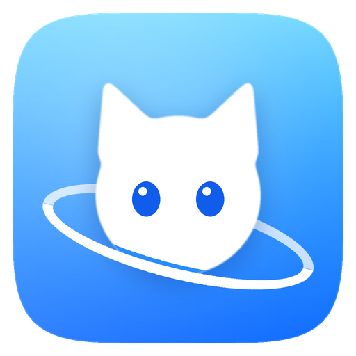
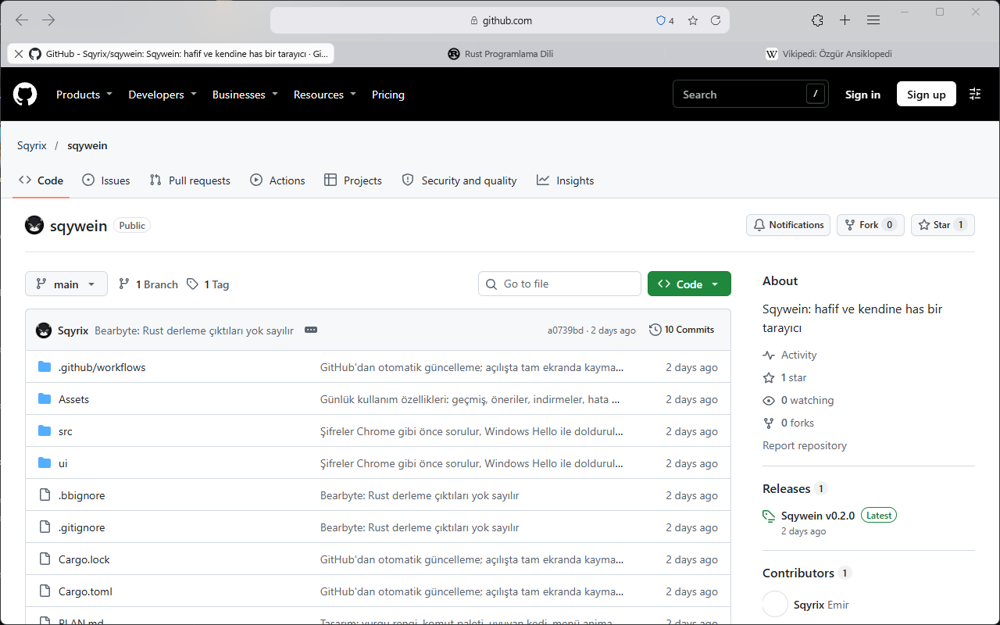
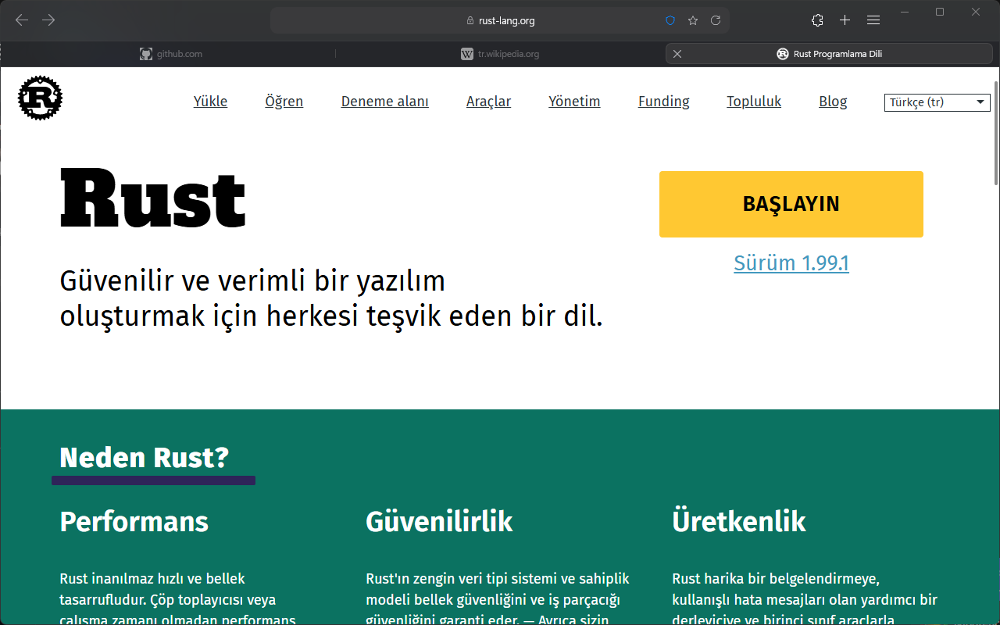

<p align="center">
  
</p>

<h1 align="center">Sqywein</h1>

<p align="center">
  <b>Windows için inanılmaz hafif, sade ve hızlı bir web tarayıcısı.</b><br>
  Cam efektli modern arayüz, YouTube'da da çalışan reklam engelleyici, Windows Hello korumalı şifre kasası.
</p>

<p align="center">
  <a href="https://github.com/Sqyrix/sqywein/releases/latest"><b>⬇ Son sürümü indir</b></a>
  ·
  <a href="#kurulum">Kurulum</a>
  ·
  <a href="#kullanım">Kullanım</a>
  ·
  <a href="#klavye-kısayolları">Kısayollar</a>
  ·
  <a href="#kaynaktan-derleme">Derleme</a>
</p>

<p align="center">
  
  
</p>

---

## Neden Sqywein?

Çoğu tarayıcı her yıl biraz daha ağırlaşıyor. Sqywein tam tersini hedefliyor: **gerçek bir tarayıcının her işini yapan, ama bilgisayarı yormayan** bir uygulama.

- **Hafif:** Tarayıcının kendi arayüzü yaklaşık **20 MB** bellekle çalışır ve **0,1 saniyede** açılır. Arayüz Rust ile yazıldı ve doğrudan Windows'un çizim altyapısını (Direct2D) kullanıyor; Electron ya da ağır bir arayüz kütüphanesi yok.
- **Modern motor:** Sayfaları Microsoft Edge'in motoru (WebView2, Chromium) gösterir. Siteler Chrome ve Edge'de nasıl görünüyorsa burada da öyle görünür.
- **Uyuyan sekmeler:** Kullanmadığın sekmeler bellekten çıkarılır, tıklayınca kaldığı yerden geri gelir. 8 siteli bir oturum diğer tarayıcıların çok altında bellekle açılır.
- **Reklamsız:** Yerleşik reklam engelleyici YouTube'daki reklamları da engeller. Eklenti kurmana gerek yok.
- **Göze hoş:** Safari'den ilham alan sade düzen, Windows 11'in bulanık cam efekti (Acrylic), yumuşak animasyonlar.

### Ölçümler

Aynı bilgisayarda, Sqywein'in eski C#/WPF sürümüyle karşılaştırma (toplam = arayüz + motorun bütün süreçleri):

| Senaryo | Eski açılış | Sqywein açılış | Eski bellek | Sqywein bellek |
|---|---:|---:|---:|---:|
| Boş başlangıç | 1132 ms | **290 ms** | 36 MB | **20 MB** |
| Reklamlı haber sitesi | 836 ms | **105 ms** | 404 MB | **289 MB** |
| 8 siteli oturumu geri yükleme | 887 ms | **110 ms** | 918 MB | **166 MB** |

Ayrıntılı ölçüm yöntemi ve Edge/Chrome karşılaştırması: [PERFORMANCE.md](PERFORMANCE.md).

---

## Özellikler

### Arayüz
- **Safari tarzı düzen:** Üstte tek satır araç çubuğu, tam ortada adres alanı, altında eşit genişlikte sekmeler.
- **Cam efekti:** Araç çubuğu, sekmeler, menüler ve başlangıç sayfası Windows 11'in bulanık camıyla yarı saydam görünür. İstersen Ayarlar'dan kapatabilirsin.
- **Akıllı adres alanı:** Yazmıyorken yalnızca site adını gösterir (`github.com`). Tıklayınca tam adres seçili gelir. Yazarken geçmişten, yer işaretlerinden ve arama motorundan öneriler sunar.
- **Dört tema:** Sistem (Windows'u izler), Açık, Koyu ve klasik mor Sqywein. Altı vurgu rengi.
- **Başlangıç sayfası:** Arama kutusu ve sık kullandığın siteler için kısayollar.
- **Komutlar adres alanında:** iki harf yazınca açık sekmeler ve tarayıcı komutları da listelenir ("geçmiş", "indirmeler"…).
- **Yer işaretleri çubuğu**, sekme sabitleme, sekmeyi sessize alma ve uyutma.
- Windows 11'in **Ek Yerleşimler** menüsü ve yerel pencere düğmeleri.

### Gizlilik ve güvenlik
- **Reklam ve izleyici engelleyici:** uBlock Origin ve EasyList listeleriyle çalışan, Brave'in açık kaynak `adblock-rust` motoru. Dört seviye: **Kapalı / Temel / İdeal / Tam** ("Tam" çerez uyarılarını da gizler). Her site için ayrı ayrı ayarlanabilir.
- **YouTube reklamları:** Video öncesi ve arası reklamları engelleyen kendi YouTube modülü.
- **Şifre kasası:** Şifreler Windows'un kendi şifrelemesiyle (DPAPI) yalnızca senin hesabında saklanır. Doldurma Chrome'daki gibi önce sorar, sonra **Windows Hello** (yüz, parmak izi ya da PIN) onayı ister. Chrome/Google Şifre Yöneticisi'nden CSV içe ve dışa aktarma.
- **Gizli sekmeler:** Geçmiş, çerez ve indirme kaydı bırakmaz.
- **Site izinleri:** Kamera, mikrofon, konum, bildirim ve pano izinleri ayarlardan yönetilir.

### Günlük kullanım
- **Chrome Web Mağazası uzantıları:** Mağaza sayfasında "Sqywein'e ekle" düğmesi çıkar. Kurmadan önce uzantının istediği izinler gösterilir.
- **İndirmeler:** İlerleme halkası, hız ve kalan süre. Dosya türüne göre doğru simge.
- **Oturum geri yükleme:** Açık sekmeler, pencere boyutu ve yeri bir sonraki açılışta aynen gelir. Google gibi sitelerdeki oturumların kapanmaz.
- **Profiller:** Birbirinden tamamen ayrı çerez, geçmiş ve şifre kasası.
- **Yakınlaştırma:** Varsayılan olarak Windows'un ölçek ayarına uyar; site başına hatırlanır.
- **Varsayılan tarayıcı** olabilir; diğer programlardan açılan bağlantılar açık pencerede yeni sekmede açılır.
- **Otomatik güncelleme:** Yeni sürüm GitHub'dan arka planda indirilir, SHA-256 özetiyle doğrulanır. Araç çubuğundaki "Güncelle" düğmesine basınca sekmelerin kaybolmadan yeni sürüm açılır.

---

## Gereksinimler

| | En az | Önerilen |
|---|---|---|
| İşletim sistemi | Windows 10 (64 bit) | Windows 11 22H2 ya da üstü |
| İşlemci | x64 | x64 |
| Bellek | 4 GB | 8 GB |
| Disk | 15 MB (program) | — |
| Ek bileşen | Microsoft Edge WebView2 Runtime | Windows 11'de zaten kurulu |

- **WebView2 Runtime** Windows 11'de hazır gelir. Windows 10'da yoksa [Microsoft'tan ücretsiz indirebilirsin](https://developer.microsoft.com/microsoft-edge/webview2/) ("Evergreen Bootstrapper").
- **Cam efekti** Windows 11 22H2 ve sonrasında çalışır. Eski sürümlerde ya da Windows'ta *Saydamlık efektleri* kapalıysa arayüz opak çizilir; diğer her şey aynı çalışır.
- **Windows Hello** (şifre doldurmayı onaylamak için) yüz tanıma, parmak izi ya da PIN ister. Windows Hello kurulu değilse Windows hesap şifresi sorulur.

---

## Kurulum

1. [Releases](https://github.com/Sqyrix/sqywein/releases/latest) sayfasından **`SqyweinSetup.exe`** dosyasını indir.
2. Çift tıkla, **Tamam** de. Yönetici izni gerekmez; Sqywein yalnızca senin kullanıcı hesabına (`%LOCALAPPDATA%\Programs\Sqywein`) kurulur.
3. Başlat menüsünde ve masaüstünde **Sqywein** kısayolu oluşur; Sqywein kendiliğinden açılır.

> **"Windows bilgisayarınızı korudu" uyarısı:** Sqywein henüz dijital olarak imzalanmadığı için Windows SmartScreen ilk açılışta bu uyarıyı gösterebilir. **Ek bilgi → Yine de çalıştır** ile devam edebilirsin. İndirdiğin dosyanın değiştirilmediğini, Releases sayfasındaki `sqywein.exe.sha256` özetiyle karşılaştırarak doğrulayabilirsin:
>
> ```powershell
> (Get-FileHash .\SqyweinSetup.exe -Algorithm SHA256).Hash
> ```

**Görev çubuğuna sabitleme:** Sqywein açıkken görev çubuğundaki simgesine sağ tıkla → **Görev çubuğuna sabitle**.

**Varsayılan tarayıcı yapma:** İlk açılışta çıkan şeritten ya da *Ayarlar → Sistem → Varsayılan tarayıcı olarak ayarla* ile. Windows'un kendi ekranı açılır; orada Sqywein'i seç.

### Güncelleme

Sqywein 12 saatte bir yeni sürüm olup olmadığına bakar. Yeni sürüm indirilip doğrulanınca araç çubuğunda **Güncelle** düğmesi çıkar. Basınca açık sekmeler kaydedilir, yeni sürüm açılır. Elle denetlemek için: *Ayarlar → Güncellemeler → Güncellemeleri denetle*. Otomatik güncellemeyi aynı yerden kapatabilirsin.

Yeni bir `SqyweinSetup.exe`'yi kurulu sürümün üzerine çalıştırmak da güncelleme yapar; verilerin korunur.

### Kaldırma

*Windows Ayarlar → Uygulamalar → Yüklü uygulamalar → Sqywein → Kaldır*. Kaldırırken tarama verilerinin (geçmiş, şifreler, çerezler) silinip silinmeyeceği ayrıca sorulur; varsayılan cevap **Hayır**dır, yani yeniden kurarsan kaldığın yerden devam edersin.

---

## Kullanım

### Adres alanı
- Bir adres (`github.com`) ya da aranacak bir şey yaz, **Enter**'a bas. Adres değilse seçili arama motorunda aranır (Google, Bing, DuckDuckGo, Yandex ya da Brave Search).
- Yazarken açılan listede ok tuşlarıyla gezin. Öneriler geçmişinden, yer işaretlerinden ve arama motorundan gelir.
- Adres alanının sağ ucunda: **yenile**, **yıldız** (yer işaretine ekle), **kalkan** (bu sitedeki engelleme durumu) ve yakınlaştırma oranı.

### Sekmeler
- Yeni sekme: araç çubuğundaki **+** ya da **Ctrl+T**. Kapatmak: sekmenin solundaki **×**, **Ctrl+W** ya da orta tıklama.
- Kapattığın sekmeyi geri getirmek: **Ctrl+Shift+T**.
- Sekmeye sağ tıklayarak sabitleyebilir, sessize alabilir, uyutabilir, çoğaltabilir ya da diğerlerini kapatabilirsin.
- Uzun süre bakmadığın sekmeler sönük görünür: bellekten çıkarılmışlardır, tıklayınca geri gelirler.

### Reklam engelleyici
- Adres alanındaki **kalkan** simgesi o sayfada engellenen istek sayısını gösterir. Tıklayınca bu site için seviye değiştirilebilir: bozulan bir sitede **Kapalı** seçip sayfayı yenilemek yeter.
- Genel seviye: *Ayarlar → Reklam engelleyici*.

### Şifreler
- Bir sitede giriş yapınca Sqywein şifreyi kaydetmek isteyip istemediğini sorar.
- Sonraki girişte kullanıcı adı alanına tıkla: kayıtlı hesaplar listelenir. Hesabı seçince Windows Hello onayından sonra doldurulur.
- Bütün şifreler: menü → **Şifreler** (`sqywein://passwords`). Google Şifre Yöneticisi'nden indirdiğin CSV'yi buradan içe aktarabilirsin.

### Uzantılar
- [Chrome Web Mağazası](https://chromewebstore.google.com)'nda bir uzantı sayfasını aç, adres alanındaki **Sqywein'e ekle** düğmesine bas.
- Yapboz simgesinden uzantıları aç, sabitle ya da yönet.
- Not: Uzantı desteğini WebView2 sağlıyor ve henüz Chrome kadar geniş değil. Reklam engelleyici, tema ve basit araç uzantıları çalışır; bazı karmaşık uzantılar kısmen çalışabilir.

### Verilerin nerede?
Bütün veriler bilgisayarında, `%LOCALAPPDATA%\Sqywein` klasöründedir. Hiçbir veri Sqywein'e ya da başka bir sunucuya gönderilmez. Bağlandığı adresler yalnızca şunlar: reklam listelerinin indirilmesi, arama önerileri (kapatılabilir) ve GitHub'daki güncelleme denetimi (kapatılabilir).

---

## Klavye kısayolları

| Kısayol | İşlev |
|---|---|
| **Ctrl+T** | Yeni sekme |
| **Ctrl+Shift+N** | Yeni gizli sekme |
| **Ctrl+W** / **Ctrl+F4** | Sekmeyi kapat |
| **Ctrl+Shift+T** | Kapatılan sekmeyi geri aç |
| **Ctrl+Tab** / **Ctrl+Shift+Tab** | Sonraki / önceki sekme |
| **Ctrl+1 … Ctrl+8** | O sıradaki sekmeye git |
| **Ctrl+9** | Son sekmeye git |
| **Ctrl+L** / **Ctrl+K** / **Ctrl+E** / **Alt+D** | Adres alanına git (sekme ve komut araması da buradan) |
| **Alt+←** / **Alt+→** | Geri / ileri |
| **F5** / **Ctrl+R** | Yenile |
| **Ctrl+D** | Yer işaretine ekle |
| **Ctrl+Shift+O** | Yer işaretleri |
| **Ctrl+H** | Geçmiş |
| **Ctrl+J** | İndirmeler |
| **Ctrl+F** | Sayfada bul |
| **Ctrl+P** | Yazdır |
| **Ctrl + / Ctrl −** | Yakınlaştır / uzaklaştır |
| **F12** | Geliştirici araçları |

---

## Sık sorulan sorular

**Sqywein neden bu kadar az bellek kullanıyor?**
Arayüz Rust ile yazıldı ve doğrudan Windows'un çizim altyapısını kullanıyor; Electron gibi kendi içinde ayrı bir tarayıcı taşımıyor. Arka plandaki sekmeler dondurulur, uzun süre kullanılmayanlar bellekten çıkarılır. Reklam engelleyici de reklam betiklerini hiç yüklemeyerek ciddi bellek kazandırır.

**Google hesabımla giriş yapabilir miyim?**
Evet. Sitelere (Gmail, YouTube vb.) normal şekilde giriş yaparsın ve oturumun açılışlar arasında korunur. Chrome Sync (yer işaretlerini ve şifreleri Google üzerinden eşitleme) şimdilik yok; şifrelerini CSV ile taşıyabilirsin.

**Bir site düzgün çalışmıyor.**
Önce adres alanındaki kalkana tıklayıp o site için engellemeyi **Kapalı** yap ve sayfayı yenile. Sorun sürüyorsa [Issues](https://github.com/Sqyrix/sqywein/issues) sayfasından bildir.

**Netflix, Spotify ya da Disney+ çalışır mı?**
Telif korumalı (DRM) içerik WebView2'nin desteğine bağlı; bazı servisler çalışmayabilir.

**Mac ya da Linux sürümü olacak mı?**
Hayır. Sqywein bilerek yalnızca Windows için yazıldı; hafifliğini Windows'un kendi bileşenlerini doğrudan kullanmasına borçlu.

---

## Kaynaktan derleme

### Gerekenler
- [Rust](https://rustup.rs) (stable, `x86_64-pc-windows-msvc`)
- Visual Studio 2022 **Derleme Araçları** ("C++ ile masaüstü geliştirme" iş yükü ve Windows SDK)
- Microsoft Edge WebView2 Runtime

### Derleme ve çalıştırma

```powershell
git clone https://github.com/Sqyrix/sqywein.git
cd sqywein
cargo build --release
.\target\release\sqywein.exe
```

Ya da `calistir.cmd`'ye çift tıkla. Bu betik:
- derleme dosyalarını proje klasörü yerine `%LOCALAPPDATA%\sqywein-build` içine koyar (OneDrive gibi eşitlenen klasörlerde işe yarar),
- her derlemede `dist\SqyweinSetup.exe` kurulum dosyasını üretir,
- geliştirme kopyasını **ayrı bir profille** (`%LOCALAPPDATA%\Sqywein-dev`) açar; böylece kurulu Sqywein'ine dokunmaz.

### Testler

```powershell
cargo test --locked
cargo clippy --locked --all-targets -- -D warnings
```

İç sayfa ve güvenlik testleri Playwright ister (`npm install playwright`):

```powershell
$env:PLAYWRIGHT_MODULE = "<playwright klasörünün tam yolu>"
node ui/test-ui.cjs
node ui/test-security.cjs
```

### Sürüm yayınlama

`Cargo.toml`'daki sürümü artır, commit'le ve aynı adla bir etiket gönder:

```powershell
git tag v0.3.0
git push origin v0.3.0
```

GitHub Actions ([release.yml](.github/workflows/release.yml)) testleri çalıştırır, derler, `SqyweinSetup.exe`, `sqywein.exe` ve SHA-256 özetini Releases'e yükler. Kullanıcıların Sqywein'i yeni sürümü kendiliğinden bulur.

### Proje yapısı

```
src/
  main.rs          Giriş noktası; kurulum modu, tek pencere kontrolü
  app.rs, app/     Pencere, sekmeler, araç çubuğu, menüler, sayfalar arası mesajlar
  engine.rs        WebView2: görünüm oluşturma, betikler, çerezler, indirmeler, uzantılar
  gfx.rs           Direct2D / DirectWrite çizim katmanı (cam desteğiyle)
  theme.rs         Renkler, ölçüler, cam katmanları
  adblock.rs       Reklam engelleyici ve YouTube modülü
  passwords.rs     DPAPI ile şifrelenen şifre kasası
  update.rs        GitHub'dan güncelleme ve SHA-256 doğrulaması
  setup.rs         Kurulum / kaldırma
  integration.rs   Windows'a tarayıcı olarak kayıt, görev çubuğu kimliği
ui/                İç sayfalar (Ayarlar, Geçmiş, İndirmeler, Şifreler…), sqywein:// adresinden sunulur
Assets/            Logo, simge ve maskot
```

Ek belgeler: [PLAN.md](PLAN.md) (yol haritası), [PERFORMANCE.md](PERFORMANCE.md) (ölçümler), [QA.md](QA.md) (davranışlar ve doğrulama), [INTEGRATION.md](INTEGRATION.md) (Windows bütünleşmesi).

---

## Yol haritası

- [x] Rust'a tam geçiş, hafif arayüz
- [x] YouTube'da da çalışan reklam engelleyici
- [x] Windows Hello korumalı şifre kasası
- [x] Otomatik güncelleme ve kurulum dosyası
- [x] Safari tarzı cam efektli tasarım
- [ ] Dijital imza (SmartScreen uyarısı olmadan kurulum)
- [ ] Sayfa çevirisi
- [ ] Dikey sekmeler, bölünmüş görünüm
- [ ] Okuma modu
- [ ] Cihazlar arası eşitleme

---

## Teşekkürler

- [Microsoft WebView2](https://developer.microsoft.com/microsoft-edge/webview2/) — sayfa motoru
- [windows-rs](https://github.com/microsoft/windows-rs) ve [webview2-com](https://github.com/wravery/webview2-rs) — Windows API bağlamaları
- [adblock-rust](https://github.com/brave/adblock-rust) (Brave) — reklam engelleme motoru
- [uBlock Origin](https://github.com/uBlockOrigin/uAssets) ve [EasyList](https://easylist.to) filtre listeleri

Hata bildirimi ve öneriler için: [Issues](https://github.com/Sqyrix/sqywein/issues).
